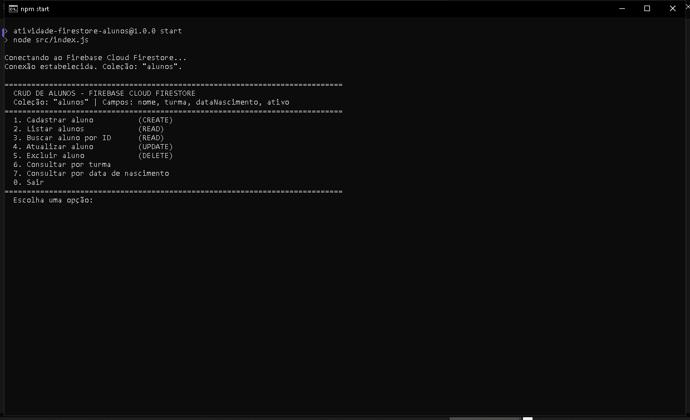
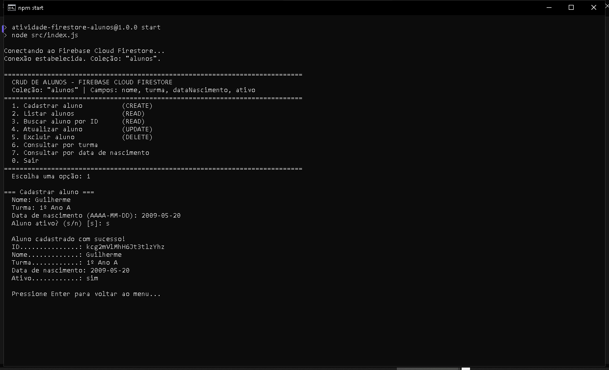
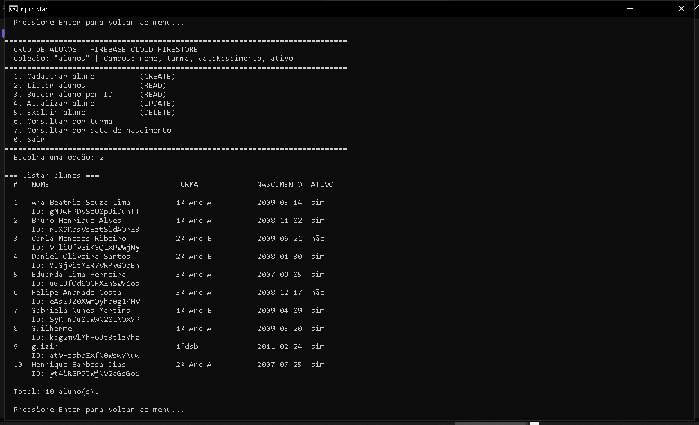
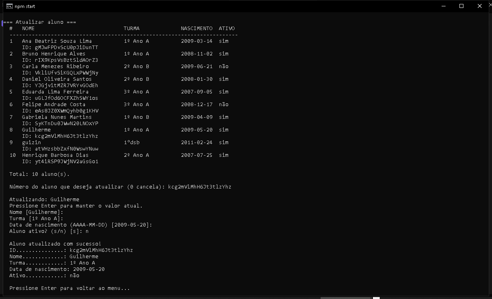
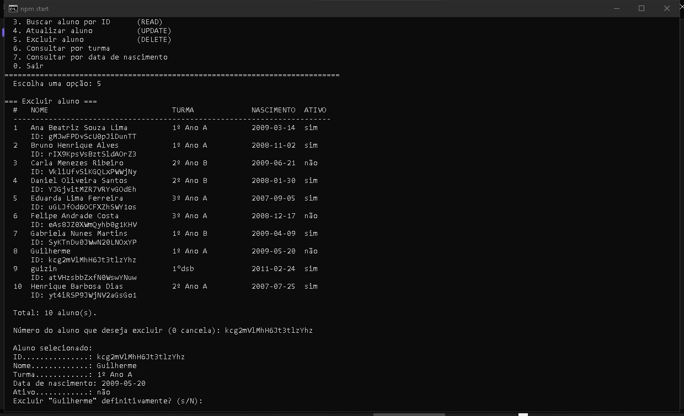
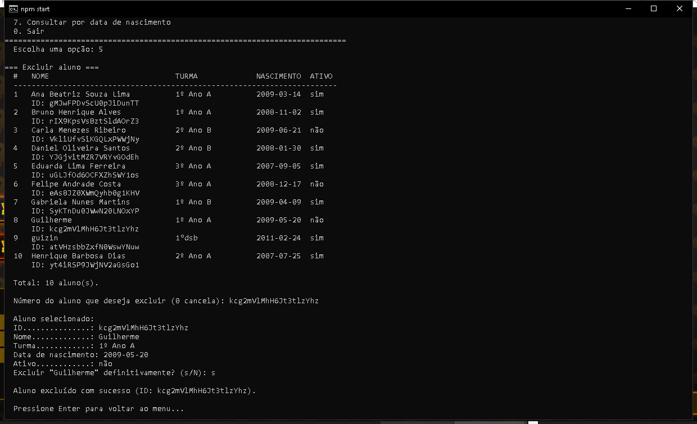
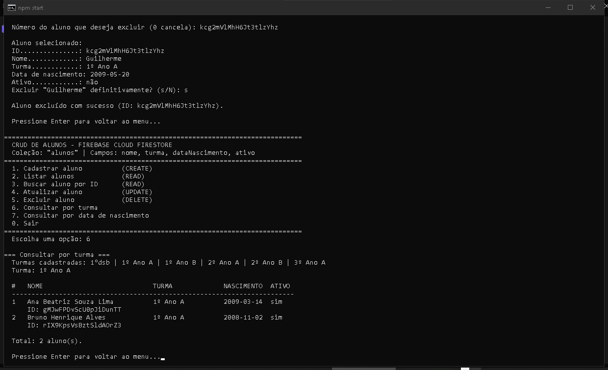
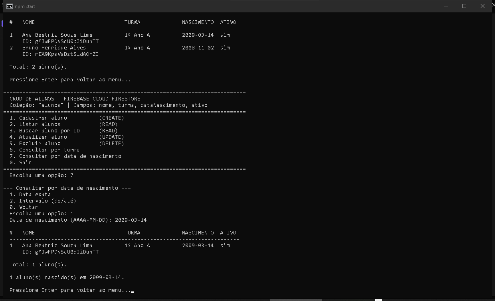
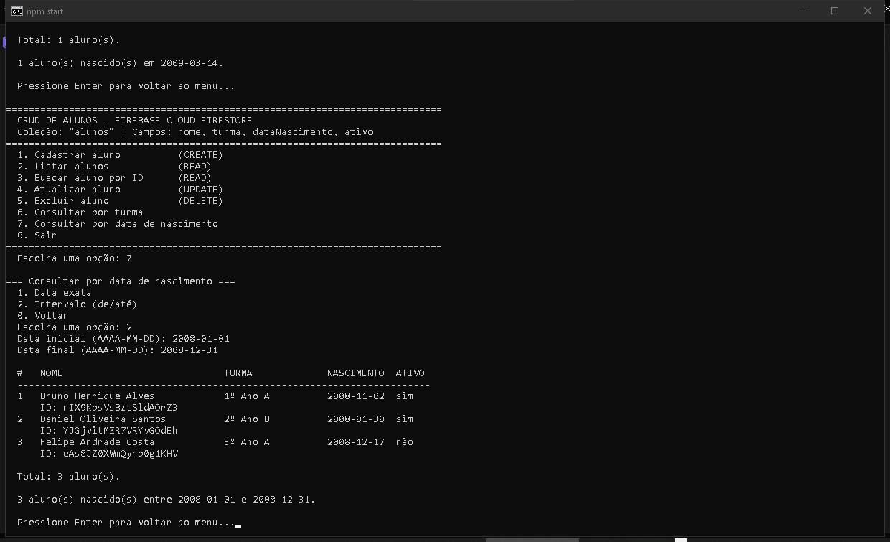

# Atividade Prática — CRUD de Alunos com Firebase Firestore

> 🔗 **Repositório:** <https://github.com/guilhermejesus777/atividade-firestore-guilherme>
>
> 📸 **Capturas de tela:** [`capturas/`](./capturas)

Aplicação em **Node.js** com **menu no terminal** para manipular a coleção
`alunos` no **Firebase Cloud Firestore** usando o **Firebase Admin SDK**.

Implementa as quatro operações do CRUD, consultas por **turma** e por **data de
nascimento** (data exata ou intervalo), validação dos dados e tratamento de
erros.

> ⚠️ **Nunca publique o arquivo `serviceAccountKey.json` no GitHub.** Ele já
> está incluído no `.gitignore` deste projeto.

---

## 1. Estrutura da coleção `alunos`

| Campo            | Tipo    | Formato / regra                     |
| ---------------- | ------- | ----------------------------------- |
| `nome`           | string  | mínimo de 3 caracteres              |
| `turma`          | string  | obrigatória (ex.: `1º Ano A`)       |
| `dataNascimento` | string  | `AAAA-MM-DD`, sem datas no futuro   |
| `ativo`          | boolean | `true` (ativo) ou `false` (inativo) |

Cada aluno é um documento da coleção, com um **ID gerado automaticamente** pelo
Firestore.

---

## 2. Estrutura do projeto

```
atividade-firestore/
├── src/
│   ├── index.js        # ponto de entrada: testa a conexão e abre o menu
│   ├── firebase.js     # inicialização do Firebase Admin SDK
│   ├── alunos.js       # CREATE, READ, UPDATE, DELETE e consultas
│   ├── validacao.js    # validação dos campos
│   ├── erros.js        # erros e mensagens amigáveis
│   ├── menu.js         # menu interativo do terminal
│   └── seed.js         # cadastra alunos fictícios para demonstração
├── test/
│   └── validacao.test.js
├── .env.example
├── .gitignore
├── package.json
└── README.md
```

---

## 3. Pré-requisitos

- [Node.js](https://nodejs.org) 20 ou superior
- Uma conta Google com acesso ao [console do Firebase](https://console.firebase.google.com)

---

## 4. Passo a passo no Firebase

### 4.1. Criar o projeto e habilitar o Firestore

1. Acesse <https://console.firebase.google.com> e clique em **Adicionar projeto**.
2. Dê um nome (ex.: `atividade-alunos`) e conclua a criação.
3. No menu lateral, abra **Build → Firestore Database**.
4. Clique em **Criar banco de dados**.
5. Escolha a localização e o modo **Produção** (o Admin SDK acessa o banco
   independentemente das regras; veja a observação no fim).
6. Confirme a criação do banco.

### 4.2. Gerar a chave da conta de serviço

1. Clique na engrenagem ⚙️ → **Configurações do projeto**.
2. Abra a aba **Contas de serviço**.
3. Clique em **Gerar nova chave privada** e confirme.
4. Um arquivo `.json` será baixado. Renomeie para `serviceAccountKey.json`
   e coloque **dentro da pasta `atividade-firestore/`**:

```
atividade-firestore/
├── serviceAccountKey.json   ← não vai para o GitHub
├── package.json
└── src/ ...
```

> Se preferir guardar a chave em outro lugar, copie `.env.example` para `.env`
> e defina `FIREBASE_SERVICE_ACCOUNT_PATH` com o caminho do arquivo.

### 4.3. Instalar e executar

```bash
cd atividade-firestore
npm install
npm start
```

Se a conexão funcionar, o menu abaixo aparece:

```
============================================================================
  CRUD DE ALUNOS - FIREBASE CLOUD FIRESTORE
  Coleção: "alunos" | Campos: nome, turma, dataNascimento, ativo
============================================================================
  1. Cadastrar aluno          (CREATE)
  2. Listar alunos            (READ)
  3. Buscar aluno por ID      (READ)
  4. Atualizar aluno          (UPDATE)
  5. Excluir aluno            (DELETE)
  6. Consultar por turma
  7. Consultar por data de nascimento
  0. Sair
============================================================================
```

> **Windows:** se o PowerShell bloquear o `npm`, use `npm.cmd install` e
> `npm.cmd start`.

### 4.4. Popular com dados fictícios (opcional)

Para gerar prints rapidamente, cadastre 8 alunos fictícios:

```bash
npm run seed
```

Se a coleção já tiver alunos, o comando não altera nada. Para cadastrar de
novo mesmo assim:

```bash
npm run seed -- --forcar
```

---

## 5. Como usar o menu

### CREATE — cadastrar aluno (opção 1)

Pede nome, turma, data de nascimento e se o aluno está ativo. Ao final, mostra
o **ID do documento** criado no Firestore.

### READ — listar e buscar (opções 2 e 3)

- **Opção 2:** lista todos os alunos, com ID, nome, turma, nascimento e status.
- **Opção 3:** busca um aluno específico pelo ID.

### UPDATE — atualizar aluno (opção 4)

Mostra a lista numerada, você escolhe o aluno e pode alterar cada campo.
**Pressione Enter sem digitar nada para manter o valor atual.**

### DELETE — excluir aluno (opção 5)

Mostra a lista, você escolhe o aluno, confere os dados e precisa confirmar
com `s` antes da exclusão definitiva.

### Consulta por turma (opção 6)

Mostra as turmas já cadastradas e filtra com
`where("turma", "==", turma)`. A comparação é exata (maiúsculas e minúsculas
importam).

### Consulta por data de nascimento (opção 7)

- **Data exata:** `where("dataNascimento", "==", "2009-03-14")`.
- **Intervalo:** `where("dataNascimento", ">=", inicio)` e
  `where("dataNascimento", "<=", fim)` — por exemplo, todos os alunos nascidos
  entre `2008-01-01` e `2008-12-31`.

---

## 6. Consultas usadas no Firestore

| Operação                | Código                                                              |
| ----------------------- | ------------------------------------------------------------------- |
| Criar                   | `db.collection("alunos").add(aluno)`                                |
| Listar                  | `db.collection("alunos").get()`                                     |
| Buscar por ID           | `db.collection("alunos").doc(id).get()`                             |
| Atualizar               | `db.collection("alunos").doc(id).update(aluno)`                     |
| Excluir                 | `db.collection("alunos").doc(id).delete()`                          |
| Por turma               | `.where("turma", "==", turma)`                                      |
| Por data exata          | `.where("dataNascimento", "==", data)`                              |
| Por intervalo de datas  | `.where("dataNascimento", ">=", inicio).where("dataNascimento", "<=", fim)` |

---

## 7. Capturas de tela

Capturas reais do programa conectado ao Firestore:

### Menu inicial


### CREATE — cadastrar aluno


### READ — listar alunos


### UPDATE — atualizar aluno


### DELETE — excluir aluno



### Consulta por turma


### Consulta por data de nascimento



> As capturas usam dados fictícios e podem ser usadas na entrega do Google
> Sala de Aula.

---

## 8. Testes das validações

As regras de nome, turma, data, ativo e ID têm testes automatizados que **não
precisam de credenciais**:

```bash
npm test
```

---

## 9. Segurança e cuidados

- **`serviceAccountKey.json` nunca vai para o GitHub.** O arquivo está no
  `.gitignore`; confira com `git status` antes de publicar.
- Se a chave for exposta por engano, **revogue** em Configurações do projeto →
  Contas de serviço e gere outra.
- A chave dá acesso administrativo ao Firebase. Use apenas em ambiente local
  ou em um servidor seguro, nunca no navegador.
- O **Admin SDK ignora as regras de segurança do Firestore**, porque roda no
  servidor com a conta de serviço. As *Rules* só valem para SDKs de cliente
  (web, Android, iOS). Para a atividade, deixe o banco em modo Produção e não
  exponha a chave.
- O arquivo `.env` também é ignorado pelo Git. O `.env.example` é o modelo
  público.

---

## 10. Problemas comuns

| Mensagem / sintoma                    | Causa provável e solução                                                                 |
| ------------------------------------- | ---------------------------------------------------------------------------------------- |
| `Conta de serviço não encontrada`     | Coloque o `serviceAccountKey.json` na pasta `atividade-firestore/` ou ajuste o `.env`.    |
| `Sem permissão para acessar` (code 7) | Firestore não criado ou API desativada. Crie o banco no console do Firebase.              |
| `Não foi possível conectar` (code 14) | Sem internet, `project_id` errado na chave ou banco não criado.                            |
| `npm` bloqueado no PowerShell         | Use `npm.cmd install` e `npm.cmd start` (política de execução do Windows).                 |
| Consulta por turma não retorna nada   | O Firestore diferencia maiúsculas/minúsculas. Copie o nome exato mostrado pelo menu.       |
| Data inválida                         | Use o formato `AAAA-MM-DD` e uma data real (ex.: `2009-03-14`).                            |

---

## 11. Publicar no GitHub

O ideal é criar um repositório **separado** para a atividade:

1. Crie um repositório vazio no GitHub (sem README).
2. Dentro da pasta `atividade-firestore/`:

```bash
git init
git add .
git status          # confirme que serviceAccountKey.json NÃO aparece
git commit -m "CRUD de alunos com Firebase Firestore"
git branch -M main
git remote add origin https://github.com/SEU-USUARIO/SEU-REPO.git
git push -u origin main
```

3. Confira no GitHub que **apenas** os arquivos do projeto foram enviados —
   nenhum `serviceAccountKey.json` e nenhum `.env`.

---

## 12. Checklist da atividade

- [x] Projeto criado no Firebase com Firestore habilitado (passo manual do aluno)
- [x] Conexão com o Firebase Admin SDK
- [x] CREATE — cadastrar aluno
- [x] READ — listar alunos e buscar por ID
- [x] UPDATE — atualizar aluno
- [x] DELETE — excluir aluno
- [x] Consulta por turma
- [x] Consulta por data de nascimento (exata e intervalo)
- [x] Menu no terminal
- [x] Dados fictícios via `npm run seed`
- [x] `serviceAccountKey.json` fora do Git
